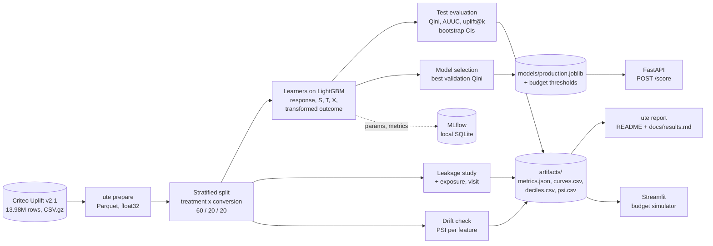

# Uplift Targeting Engine

[](https://github.com/duan-n2d/uplift-targeting-engine/actions/workflows/ci.yml)

A CDP or CRM team can afford to send a voucher to only a fraction of its customers. The usual
rule, "send it to the people most likely to buy", spends much of the budget on **sure things**
(they would have bought anyway) and some of it on **sleeping dogs** (the message puts them off).
What the business actually wants is the people whose behaviour the voucher *changes*.

This project ranks customers by **uplift**, the estimated causal effect of the voucher on their
conversion, using the 14-million-row randomised experiment Criteo released for this purpose. It
compares uplift learners with the response-model baseline on a held-out test split, picks a
production model on the validation split only, and serves it behind a scoring API and a budget
simulator.

## Results

<!-- RESULTS:START -->
Criteo Uplift v2.1, **13,979,592 rows**; test split 2,795,919 rows; treatment share 85.0%; 200 Poisson-bootstrap replicates (95% intervals in brackets). Outcome: **conversion**.

| | Value |
|---|---|
| Conversion rate, treated / control | 0.3089% / 0.1939% |
| Average treatment effect (= expected uplift of random targeting) | 0.1151 pp |
| Production model (best **validation** Qini) | S-learner |
| Qini coefficient, test | 0.168 [0.140, 0.200] |
| uplift@20%, test | 0.459 [0.388, 0.521] pp |
| Incremental conversions per 100,000 customers, top 20% targeted | **92** vs 23 for random 20% (**4.0x**) |
| Same budget, response model | 96 (Qini 0.185) |
| Leakage study: response-model ROC AUC, clean vs with `exposure`+`visit` | 0.930 vs **0.977** |
<!-- RESULTS:END -->

Full tables (every learner, both outcomes, deciles, leakage study, drift): [docs/results.md](docs/results.md).
All numbers above and in that file are generated from `artifacts/metrics.json` by `ute report`;
none are typed by hand.

### What the results say

* **Targeting by model beats random by a wide margin.** Every learner except the T-learner
  roughly quadruples the incremental conversions of a random 20% send.
* **On conversion, uplift learners do not beat the response model here.** The S-, X- and
  transformed-outcome learners and the plain response model are statistically tied (their
  intervals overlap). On this dataset the people most likely to convert are also the people the
  ad moves most, so ranking by propensity is already a good uplift ranking. The production
  model is still an uplift learner, chosen by validation Qini among uplift learners only,
  because only an uplift model can flag customers the voucher does *not* move.
* **On visit, the S-learner does beat the response model**, with non-overlapping intervals on
  uplift@10%: there, likelihood and persuadability diverge more.
* **The T-learner is the weakest.** Its control-arm model sees only 15% of the rows and stops
  after a few dozen trees, so the difference of two noisy models is mostly noise.
* **Leakage inflates everything**, see [below](#leakage-why-exposure-and-visit-are-not-features).

How to read them:

* **uplift@20%** is the treated-minus-control conversion rate inside the top 20% of the ranking.
  Random targeting gets the average treatment effect (ATE) in expectation.
* **Qini coefficient** and **AUUC** are normalised areas: 1 is a perfect ranking, 0 is random. On
  a rare outcome (about 0.3% conversion) they are small for every model, because most of the
  "perfect" area comes from knowing each customer's outcome, which no model can. Compare models
  with each other and with the response baseline, not with 1.
* Brackets are 95% Poisson-bootstrap intervals on the test split.

## Demo

Budget simulator (Streamlit, reads only the small measured artifacts):
*Hugging Face Space link goes here once deployed, see [Deploy](#deploy-the-simulator-to-a-hugging-face-space).*

Run it locally with `make app`.

## Architecture



## Quickstart

```bash
python -m venv .venv && source .venv/bin/activate   # Windows: .venv\Scripts\activate
pip install -e ".[track,serve,app,dev]"

ute prepare          # download ~300 MB from Criteo's Hugging Face repo, write Parquet
ute train            # all rows, every learner, both outcomes (91 min on a busy 14-core laptop)
ute train --sample-frac 0.1 --n-boot 50   # quick version
ute report           # regenerate docs/results.md and the block above
pytest               # synthetic fixture with a known uplift; no download needed

ute serve            # scoring API on :8000
make app             # budget simulator on :8501
mlflow ui --backend-store-uri sqlite:///mlflow.db   # browse runs
```

Score a batch:

```bash
curl -s localhost:8000/score -H 'content-type: application/json' -d '{
  "budget": 0.2,
  "customers": [{"id": "c1", "f0": 12.6, "f1": 10.1, "f2": 8.9, "f3": 4.7, "f4": 10.3,
                 "f5": 4.1, "f6": 0.29, "f7": 4.8, "f8": 3.9, "f9": 13.2, "f10": 5.3, "f11": -0.17}]
}'
```

The decision uses the score threshold that selects the top `budget` share of the *validation
population*, so a customer gets the same answer whether they are scored alone or in a batch of
50,000.

## Leakage: why `exposure` and `visit` are not features

The dataset has two columns that are recorded **after** the treatment was assigned:

* `exposure`: whether the treated user was actually shown the ad. Always 0 in the control group.
* `visit`: whether the user visited the site. Every conversion goes through a visit.

Both are strongly predictive, and adding them makes the offline numbers look better. They are
still unusable: when the marketing team decides who gets the voucher, nobody knows yet who will
be exposed or who will visit. Worse, both are *caused* by the treatment, so conditioning on them
compares treated and control customers who are no longer comparable. The pipeline refits the
response model and the T-learner with these columns and reports the difference
([docs/results.md, Leakage study](docs/results.md#leakage-study)); production models use
`f0`-`f11` only, and the API schema accepts nothing else.

## Design decisions

* **Learners written by hand on LightGBM**, about 200 lines in
  [`src/ute/learners.py`](src/ute/learners.py), instead of depending on `causalml`, which does not
  install cleanly on recent Python. The metric code is cross-checked against `scikit-uplift` in
  the test suite when that package is installed.
* **Constant propensity.** The data comes from a randomised trial (85% treated), so the
  X-learner and transformed-outcome learner use the observed treatment share instead of a
  fitted propensity model, which could only add noise.
* **Selection on validation, reporting on test.** The production model is the uplift learner
  with the best validation Qini; the test split is used once, for the numbers in the README.
* **Stratified split on treatment x conversion.** Control converters are rare (about 0.19% of
  2.1M control rows), and an unlucky split moves every metric.
* **Poisson bootstrap.** The ranking is computed once; each replicate only reweights cumulative
  sums, so 200 replicates on 2.8M test rows take seconds.
* **Population thresholds in the API**, stored with the model, instead of "top k% of whatever
  batch arrives", which would make decisions depend on the batch.
* **Visit learners fit on a 20% sample.** Visit is the secondary outcome and has 16x more
  positives than conversion, so early stopping runs much longer. Its learners are fitted on a
  random 20% of train/valid (`--secondary-fit-frac`) and still evaluated on the full test
  split. Conversion learners use all rows.
* **LightGBM uses half the cores (at most 8).** OpenMP threads spin at barriers, so on a busy
  machine `n_jobs=-1` made training an order of magnitude slower. Override with `UTE_N_JOBS`.
* **Artifacts are tiny and committed** (curves on a 101-point grid, deciles, PSI), so the
  simulator and the README never need the 14M rows.

## Drift check

Before scoring a new batch, compare each feature's distribution with training using the
Population Stability Index ([`src/ute/drift.py`](src/ute/drift.py)): below 0.1 stable, 0.1 to
0.25 watch, above 0.25 investigate. The report shows PSI for the real test split and for a
deliberately shifted copy, so you can see what an alert looks like.

## Deploy the simulator to a Hugging Face Space

```bash
make space                                    # assembles dist/space (app + artifacts + Dockerfile)
hf auth login
hf repo create uplift-budget-simulator --repo-type space --space_sdk docker
hf upload <your-user>/uplift-budget-simulator dist/space . --repo-type space
```

## Honest limits

* **One experiment, anonymised features.** `f0`-`f11` are projected and have no business
  meaning, so the model cannot explain *why* a customer responds. The method transfers; the
  model does not.
* **Offline evaluation only.** A real deployment would validate the ranking with a fresh
  holdout campaign (treat the top k, keep a random control inside it) before trusting it.
* **Small effects.** The treatment raises conversion by about a tenth of a percentage point on
  average, so intervals are wide relative to differences between the better learners. Read the
  intervals before declaring a winner.
* **Little tuning.** One LightGBM configuration for every learner (learning rate 0.1, early
  stopping, 1,000-tree cap). The response model and the T-learner's treated-arm model hit the
  cap, so they might improve with more trees; no hyperparameter search was run.
* **Visit learners are fitted on a 20% sample** of train/valid to keep the run under two hours;
  they are evaluated on the full test split.
* **No cost model per customer.** The simulator assumes the same voucher cost and margin for
  everybody.
* **The drift shift is simulated.** The dataset has no time dimension, so there is no real
  "next month" batch to monitor.
* **CI runs the synthetic fixture only.** The full run is reproducible with the commands above
  but is not executed in CI.

## Data and licence

Data: *Criteo Uplift Modeling Dataset v2.1*, Criteo AI Lab, released under
[CC BY-NC-SA 4.0](https://creativecommons.org/licenses/by-nc-sa/4.0/). Non-commercial use only;
the data is downloaded at run time and never stored in this repository. Reference:
E. Diemert, A. Betlei, C. Renaudin, M.-R. Amini, *A Large Scale Benchmark for Uplift Modeling*,
AdKDD 2018.

Code: MIT, see [LICENSE](LICENSE).
